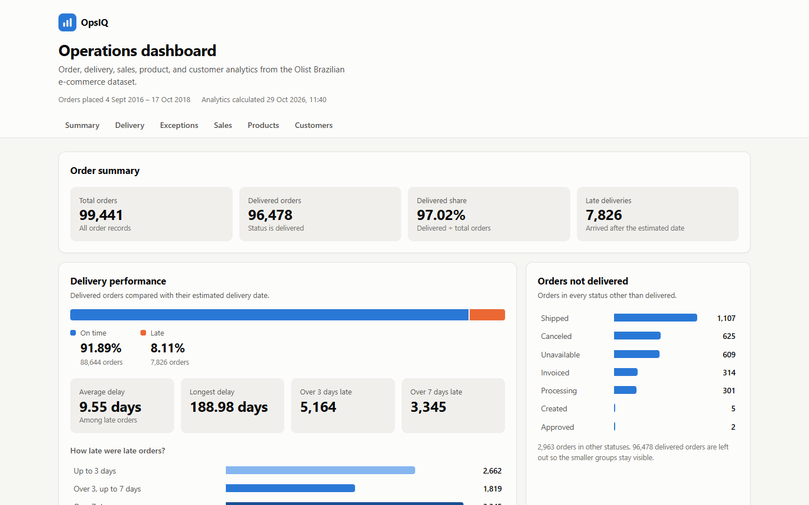
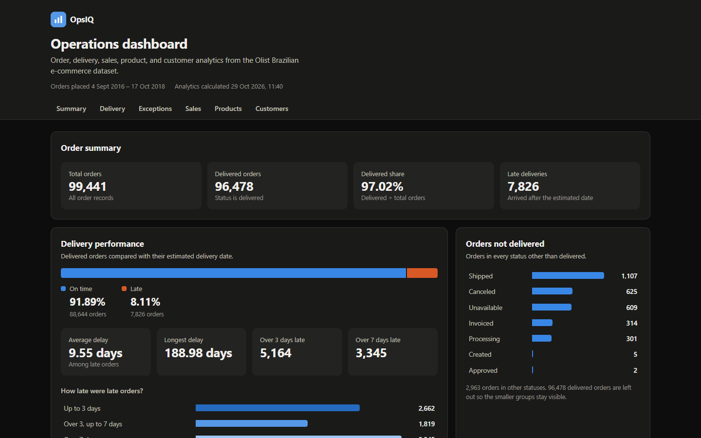
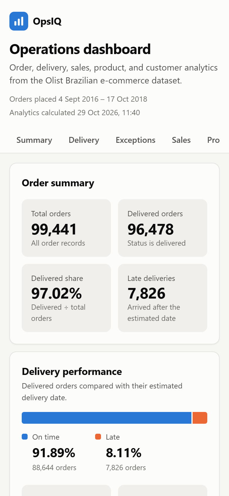
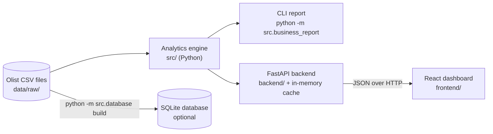

# OpsIQ — Business Operations Intelligence Platform

> Turns ~100,000 raw e-commerce orders into tested, explainable operations metrics: a Python analytics engine, a FastAPI backend, a React dashboard, and an optional SQL database.



**Status:** Working locally end to end (CLI report, API, dashboard, SQLite). CI passes on GitHub. Deployment files are prepared but the app is **not deployed yet**.

**About "AI-Powered":** this is the long-term vision for the project. The current version uses **no artificial intelligence or machine learning**. Every number comes from rule-based Python and SQL calculations. An optional AI feature is described under [Future improvements](#future-improvements).

## Contents

1. [Business problem](#business-problem)
2. [Features](#features)
3. [Architecture](#architecture)
4. [Technology stack](#technology-stack)
5. [Repository structure](#repository-structure)
6. [Dataset](#dataset)
7. [Getting started](#getting-started)
8. [Running the tests](#running-the-tests)
9. [API reference](#api-reference)
10. [Configuration](#configuration)
11. [SQL database (optional)](#sql-database-optional)
12. [Key results](#key-results)
13. [Error handling, security, and performance](#error-handling-security-and-performance)
14. [CI/CD and deployment](#cicd-and-deployment)
15. [Limitations](#limitations)
16. [Future improvements](#future-improvements)

More detail: [Architecture](docs/ARCHITECTURE.md) · [Deployment guide](docs/DEPLOYMENT.md) · [Learning guide](docs/LEARNING_GUIDE.md) · [Project handover](docs/PROJECT_HANDOVER.md)

## Business problem

An online marketplace processes thousands of orders a day. Operations managers need quick, trustworthy answers to questions such as:

- How many orders were delivered, and how many arrived late?
- How late were they, and which orders need investigating first?
- Where does product revenue come from, and how do customers pay?
- How many customers come back to buy again?

OpsIQ answers these from the raw order data, using one set of tested business rules shared by every interface.

**Target users:** operations and logistics managers (the dashboard), analysts (the SQL database and CLI report), and developers who integrate the metrics into other tools (the API).

## Features

| Area | What it does |
|---|---|
| Analytics engine (`src/`) | Order, delivery, sales, product, and customer metrics in plain Python. Data-quality checks for missing, duplicate, invalid, and out-of-order values. |
| CLI report | `python -m src.business_report` prints the full business report. |
| REST API (`backend/`) | 9 read-only JSON endpoints built with FastAPI, with response schemas, input validation, safe error messages, CORS, and caching. |
| Dashboard (`frontend/`) | React dashboard: summary cards, delivery performance, order status chart, a delivery-exceptions table with severity labels, sales, products, and customers. Responsive, keyboard accessible, light and dark themes. |
| SQL database (`sql/`, `src/database.py`) | Optional SQLite copy of the data with keys, foreign keys, and indexes, plus 7 documented example queries that are checked against the Python results. |
| Quality | 191 automated tests across Python, the API, and the frontend. GitHub Actions workflow for CI. |

| Desktop (dark theme) | Mobile |
|---|---|
|  |  |

The full-page desktop screenshot is in [docs/screenshots/dashboard-desktop.png](docs/screenshots/dashboard-desktop.png).

## Architecture



- The **CSV files are the source of truth**. The database is an optional copy for SQL analysis.
- The **business rules live in one place** (`src/`). The CLI report and the API call the same functions, so they always agree.
- The API calculates each result **once**, caches it in memory, and returns it in milliseconds afterwards.
- The dashboard only **displays** numbers from the API; it never calculates business metrics itself.

See [docs/ARCHITECTURE.md](docs/ARCHITECTURE.md) for data flow, caching, error handling, the database schema, and the testing strategy.

## Technology stack

| Layer | Technology | Why |
|---|---|---|
| Analytics | Python 3.14, standard library only (`csv`, `datetime`, `collections`) | No dependencies; easy to read and test. |
| API | FastAPI, Pydantic, Uvicorn | Validation, response schemas, and interactive docs at `/docs`. |
| Frontend | React 19, Vite 8, plain CSS | Small dependency set. Charts are accessible HTML bars, so no charting library is needed. |
| Database | SQLite (`sqlite3` from the standard library) | Free, file-based, no server to run. |
| Tests | `unittest`, FastAPI `TestClient`, Vitest, Testing Library | One standard tool per language. |
| CI/CD | GitHub Actions; Render Blueprint (prepared) | Free for public repositories / free tiers available. |

## Repository structure

```text
OpsIQ/
├── src/                     Version 1 analytics engine (Python standard library)
│   ├── business_report.py   Full CLI report (main entry point)
│   ├── data_loader.py       Loads the orders CSV
│   ├── data_validator.py    Data-quality checks
│   ├── data_analyzer.py     Orders by status
│   ├── delivery_analyzer.py On-time vs late, delays
│   ├── delivery_exceptions.py  Late orders, longest delay first
│   ├── sales_analyzer.py    Revenue, freight, payments
│   ├── product_analyzer.py  Categories and products
│   ├── customer_analyzer.py Unique and repeat customers
│   ├── database.py          Optional SQLite build, queries, verification
│   └── download_data.py     Downloads the dataset from Kaggle
├── tests/                   Tests for src/ (unittest)
├── backend/                 FastAPI application (own virtual environment)
│   ├── app/
│   │   ├── main.py          App, CORS, error handler, startup warm-up
│   │   ├── config.py        Settings from environment variables
│   │   ├── schemas.py       Response shapes
│   │   ├── api/             Routes: health and analytics
│   │   └── services/        Loads data, calls src/, caches results
│   ├── tests/
│   └── requirements.txt
├── frontend/                React dashboard (Vite)
│   ├── src/
│   │   ├── api/client.js    All HTTP requests
│   │   ├── hooks/useApi.js  Loading / error / data state
│   │   ├── components/      Layout, cards, charts, table, sections
│   │   └── utils/           Formatting and chart data helpers
│   ├── .env.example
│   └── package.json
├── sql/
│   ├── schema.sql           Tables, keys, indexes
│   └── queries/             Example analysis queries
├── data/
│   ├── raw/                 Olist CSV files (not committed)
│   └── processed/           Generated SQLite database (not committed)
├── docs/                    Architecture, deployment, learning guide, screenshots
├── .github/workflows/ci.yml Continuous integration
├── render.yaml              Deployment blueprint (prepared, not yet used)
└── .python-version
```

## Dataset

[Brazilian E-Commerce Public Dataset by Olist](https://www.kaggle.com/datasets/olistbr/brazilian-ecommerce) (Kaggle, licence **CC BY-NC-SA 4.0**): about 100,000 anonymised orders placed between September 2016 and October 2018.

The CSV files are **not committed** to this repository. Download them with:

```powershell
python -m src.download_data
```

or manually from Kaggle into `data/raw/`.

| File | Used for |
|---|---|
| `olist_orders_dataset.csv` | Orders, statuses, and delivery dates (99,441 rows) |
| `olist_order_items_dataset.csv` | Item prices and freight (112,650 rows) |
| `olist_order_payments_dataset.csv` | Payment methods and values (103,886 rows) |
| `olist_products_dataset.csv` | Product categories (32,951 rows) |
| `olist_customers_dataset.csv` | Customer identities and states (99,441 rows) |
| `product_category_name_translation.csv` | English category names (71 rows) |
| `olist_sellers_dataset.csv` | Sellers (SQL database only) |

**Relationships:** each order belongs to one `customer_id`; one person (`customer_unique_id`) can have several `customer_id`s, one per order. Each order has zero or more items and payments; each item refers to one product and one seller. These relationships were checked: the data has no orphan rows and no duplicate keys.

## Getting started

All commands are for **Windows PowerShell**. You need Python 3.10+ (developed with 3.14), Node.js 22.12+ (developed with Node 24; the test runner needs 22.12 or later), and Git.

### 1. Get the code and data (project root)

```powershell
git clone https://github.com/SwomBR/OpsIQ.git
cd OpsIQ
python -m src.download_data
```

### 2. Run the CLI report (project root)

```powershell
python -m src.business_report
```

The report needs no packages. It ends with `END OF OPSIQ REPORT`. Other reports: `python -m src.data_validator`, `python -m src.delivery_exceptions`, and the other modules in `src/`. Always use `python -m`; `python src/business_report.py` cannot find the `src` package.

### 3. Start the API (terminal 1, `backend` folder)

```powershell
cd backend
python -m venv .venv                         # first time only
.\.venv\Scripts\Activate.ps1
python -m pip install -r requirements.txt    # first time only
uvicorn app.main:app --reload
```

If PowerShell blocks `Activate.ps1`, run `Set-ExecutionPolicy -Scope CurrentUser RemoteSigned` once.

The API runs at http://127.0.0.1:8000. Interactive documentation: http://127.0.0.1:8000/docs. The server calculates all metrics in the background when it starts (about 10 seconds); requests that arrive earlier wait for that calculation.

### 4. Start the dashboard (terminal 2, `frontend` folder)

```powershell
cd frontend
npm install        # first time only
npm run dev
```

Open http://localhost:5173. The dashboard expects the API at `http://127.0.0.1:8000`; to change it, see [Configuration](#configuration).

## Running the tests

| Suite | Folder | Command |
|---|---|---|
| Analytics, database, download helper | project root | `python -m unittest discover -s tests -v` |
| API | `backend` (venv active) | `python -m unittest discover -s tests -v` |
| Dashboard | `frontend` | `npm test` |
| Dashboard lint and production build | `frontend` | `npm run lint` and `npm run build` |

None of the tests need the Olist dataset; they create small sample files. Latest local results (29 Oct 2026, Windows): **89** Python tests, **61** API tests, **41** frontend tests — all passing.

## API reference

All endpoints use `GET`, return JSON, and live under `/api/v1`. Full schemas: http://127.0.0.1:8000/docs.

| Endpoint | Returns |
|---|---|
| `/health` | `{"app": "OpsIQ", "status": "healthy"}`. Never reads the data. |
| `/` | Welcome message and a link to `/docs`. |
| `/analytics/summary` | Total orders, delivered orders, delivered percentage, late-delivered orders. |
| `/analytics/orders-by-status` | Total orders and the count in each status. |
| `/analytics/delivery-performance` | Orders analysed, on-time / late counts and percentages, skipped orders, average and maximum delay, orders over 3 and 7 days late. |
| `/analytics/delivery-exceptions?limit=10` | Total late orders plus the `limit` most delayed (1–100, default 10): order ID, estimated and actual delivery, days late. No customer data. |
| `/analytics/dataset-info` | First and last order purchase dates, and when the server calculated the metrics. |
| `/analytics/sales` | Product revenue, freight value, orders with items, average product value per order, payment totals by method. |
| `/analytics/products` | Catalog size, products missing a category, top 10 categories by revenue, top 10 products by items sold. |
| `/analytics/customers` | Unique customers, repeat customers and percentage, unique customers per state. Individual customers are never returned. |

Example: `GET /api/v1/analytics/summary`

```json
{"total_orders": 99441, "delivered_orders": 96478, "delivered_percentage": 97.02, "late_delivered_orders": 7826}
```

Percentages and days are rounded to 2 decimals. When there is nothing to divide by (for example, no orders), percentages and averages are `null`.

| Situation | Status | Response |
|---|---|---|
| A CSV file is missing | 503 | Names the missing file (never the folder path). |
| A file cannot be read or contains bad values | 500 | Short message; details go to the server log. |
| Invalid `limit` (`0`, `500`, `abc`) | 422 | Which value was wrong and why. |
| Unknown address | 404 | `{"detail": "Not Found"}` |
| Any other unexpected error | 500 | `{"detail": "An unexpected server error occurred."}` |

## Configuration

Settings come from environment variables. None of them are secrets, and the defaults work for local development.

**Backend** (`backend/app/config.py`):

| Variable | Default | Purpose |
|---|---|---|
| `OPSIQ_ENV` | `development` | Environment name, shown in the startup log. |
| `OPSIQ_DATA_DIR` | `data/raw` | Folder with the CSV files. Relative paths start at the project root. |
| `OPSIQ_CORS_ORIGINS` | `http://localhost:5173,http://127.0.0.1:5173` | Comma-separated web addresses allowed to call the API from a browser. |
| `OPSIQ_LOG_LEVEL` | `INFO` | Log detail for OpsIQ's own messages. |
| `OPSIQ_PRELOAD_DATA` | `true` | Calculate all metrics in the background at startup. |

```powershell
$env:OPSIQ_CORS_ORIGINS = "http://localhost:5173,https://my-dashboard.example.com"
uvicorn app.main:app
```

**Frontend** (`frontend/.env.local`, copied from `frontend/.env.example`):

| Variable | Default | Purpose |
|---|---|---|
| `VITE_API_BASE_URL` | `http://127.0.0.1:8000` | Address of the API. |

Vite only exposes variables that start with `VITE_`, and it copies them into the built JavaScript, so anyone can read them. **Never put secrets in frontend variables.** After changing the value, restart `npm run dev` or rebuild.

## SQL database (optional)

The CSV workflow does not need the database. It is a separate tool for SQL analysis.

```powershell
# project root
python -m src.download_data --with-database-files   # adds the sellers file
python -m src.database build      # creates data/processed/opsiq.db (about 20 s)
python -m src.database list       # lists the example queries
python -m src.database query delivery_performance
python -m src.database late --min-days 30 --limit 5
python -m src.database verify     # compares SQL results with the Python analytics
```

- 7 tables: `customers`, `orders`, `order_items`, `order_payments`, `products`, `sellers`, `category_translations`, with primary keys, foreign keys, and indexes ([sql/schema.sql](sql/schema.sql)).
- Example queries in [sql/queries/](sql/queries/): orders by status, delivery performance, the 10 latest deliveries, late deliveries by month, revenue by category, repeat customers, and orders per customer.
- Rebuilding is always safe: the database is built in a temporary file and only replaces the old one if every table imported. Duplicate rows are skipped and counted; empty values become `NULL`; bad values and broken relationships stop the build with the file and line number.
- User input is always passed as SQL parameters (`?`), never pasted into SQL text.
- `verify` on the full dataset: **33 of 33 metrics match** the Python analytics.

## Key results

From the full dataset. The CLI report, API, dashboard, and SQL database all give these values.

| Metric | Value |
|---|---:|
| Total orders | 99,441 |
| Delivered orders | 96,478 (97.02%) |
| Delivered orders with valid dates (analysed) | 96,470 |
| On time | 88,644 (91.89%) |
| Late | 7,826 (8.11%) |
| Average delay of late orders | 9.55 days |
| Longest delay | 188.98 days |
| More than 3 / 7 days late | 5,164 / 3,345 |
| Product revenue (sum of item prices) | R$ 13,591,643.70 |
| Freight value | R$ 2,251,909.54 |
| Average product value per order | R$ 137.75 |
| Unique / repeat customers | 96,096 / 2,997 (3.12%) |

**Metric definitions**

- **Delivered percentage** = orders with status `delivered` ÷ all orders.
- **On time** = delivered on or before the estimated date and time. **Late** = after it. Delivered orders missing a date are skipped (8 orders).
- **Product revenue** = sum of item prices. It is not total company revenue and excludes freight.
- **Average product value per order** = product revenue ÷ orders that have items.
- **Repeat customer** = a person (`customer_unique_id`) with more than one order.

## Error handling, security, and performance

- **Safe errors:** error responses never include file paths or stack traces; details go to the server log only.
- **Privacy:** the API and dashboard show only order IDs and aggregate counts. Customer IDs, cities, and spending per customer are never returned.
- **Read-only API:** only `GET` is allowed, and CORS allows only the configured dashboard addresses.
- **No secrets:** there are no credentials in the project. `.env` files are ignored by Git.
- **SQL injection:** user values are always sent as query parameters.
- **Performance:** delivery metrics take a few seconds to calculate for ~100k orders. The API calculates each result once and caches it (only the results, not the raw rows), so later requests take about 5 ms and the server uses about 165 MB of memory. A lock makes simultaneous first requests share one calculation. **Restart the server to load new CSV files.**

## CI/CD and deployment

- **CI:** [.github/workflows/ci.yml](.github/workflows/ci.yml) runs the Python, API, and frontend tests, the frontend lint, and the production build on every push and pull request. It uses only test data. The same steps were reproduced locally; the workflow passes on GitHub.
- **Deployment:** [render.yaml](render.yaml) describes the API (Python web service) and dashboard (static site) on Render. During the build, the API downloads the public dataset from Kaggle; no credentials are needed. A production rehearsal (production settings, downloaded data, production build, strict CORS) passed locally. Step-by-step instructions, costs, and limits: [docs/DEPLOYMENT.md](docs/DEPLOYMENT.md).

## Limitations

- **Not deployed yet.**
- **Static data:** metrics describe the 2016–2018 dataset. New data requires restarting the API.
- **No filters:** the dashboard shows whole-dataset totals; there is no date or region filter.
- **Startup time:** the API takes about 10 seconds to calculate everything. On a free hosting plan, add about 1 minute when the service wakes up after 15 minutes without traffic.
- **"Late" compares timestamps:** every estimated date is at midnight, so an order delivered later on the estimated day counts as late (1,292 of the 7,826 late orders).
- **Causes are not analysed:** OpsIQ shows which orders were late, not why.
- **No authentication:** acceptable for public, anonymised, aggregate data; required before adding private data.
- **Data quality:** the validator found 1,382 orders with out-of-order timestamps; they are reported, not corrected.

## Future improvements

1. Date-range and state filters (API query parameters and dashboard controls).
2. Delivery delay analysis by seller, state, and product category to find causes.
3. Serve the API from the SQLite database instead of CSV files, for faster startup.
4. **Optional AI briefing:** a backend endpoint that sends only the calculated aggregate metrics (never customer data) to a language model and returns a short management summary, clearly labelled as generated text, with the facts shown beside it. It would need an API key stored on the backend and has a per-request cost, so it is not built yet.
5. Browser end-to-end tests in CI.

---

Built as a hands-on learning and portfolio project. Data © Olist, CC BY-NC-SA 4.0.
