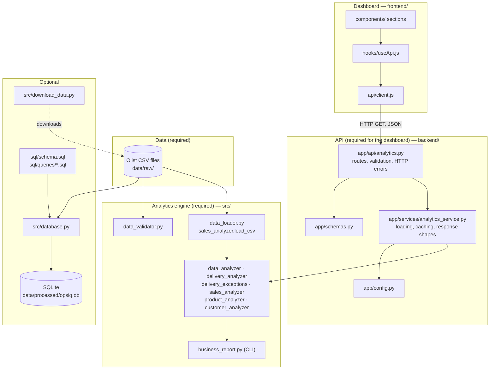
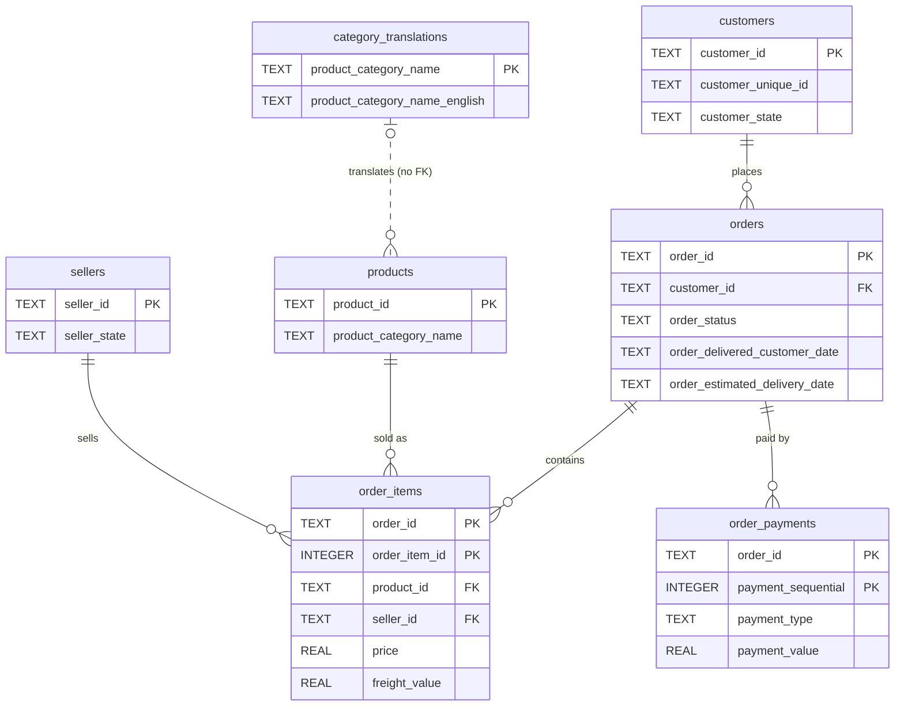
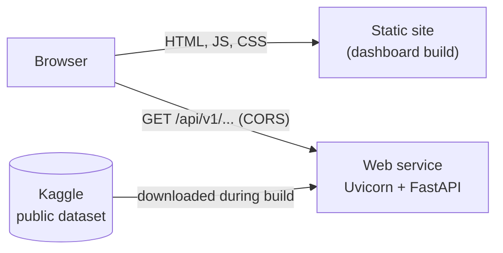

# OpsIQ Architecture

This document explains how OpsIQ is put together: which part does what, how data moves through it, and why it was designed this way.

## 1. Components

| Component | Required? | Responsibility |
|---|---|---|
| CSV files | Yes | The source of truth. Never modified by OpsIQ. |
| `src/` analytics engine | Yes | All business rules. Pure functions that take rows and return dictionaries. Uses only the Python standard library. |
| CLI report | No (but kept) | Prints every metric to the terminal. Version 1's original interface. |
| `backend/` API | For the dashboard | Turns the analytics into HTTP endpoints. Knows nothing about business rules beyond calling `src/`. |
| `frontend/` dashboard | No | Displays API results. Never calculates business metrics. |
| SQLite database | No | A relational copy of the data for SQL analysis. Neither the API nor the CLI depends on it. |
| `download_data.py` | No | Fetches the public dataset (used during deployment). |

## 2. Data flow

How a number travels from a CSV file to the screen, using "late-delivered orders" as the example:

1. **CSV → Python rows.** `open_order()` reads `olist_orders_dataset.csv` with `csv.DictReader`. Each row becomes a dictionary of strings.
2. **Rows → metrics.** `find_delivery_exceptions()` keeps delivered orders whose delivery timestamp is after the estimated one and sorts them by delay.
3. **Metrics → cache.** `calculate_order_metrics()` runs every order-level calculation once and stores the results in a frozen `OrderMetrics` object. `lru_cache` keeps that object; the raw rows are released.
4. **Cache → JSON.** The `/analytics/summary` route receives the cached object through `Depends(get_order_metrics)`, `get_business_summary()` picks the fields, and Pydantic's `BusinessSummary` schema checks and serialises them.
5. **JSON → screen.** `SummarySection` calls `useApi(api.getSummary)`. `fetchJson()` requests the URL, `useApi` tracks loading/error/data, and `StatTile` displays `formatNumber(7826)` → `7,826`.

The CLI report runs steps 1–2 and prints the result. Because the API uses the same functions, the two cannot disagree; tests in `backend/tests/` compare them directly.

## 3. API design

- **Versioned paths** (`/api/v1/...`) so a future incompatible version can live alongside this one.
- **Read-only:** every endpoint is `GET`, which matches the CORS configuration.
- **One endpoint per dashboard section.** Sections load independently, so one failure does not blank the whole page.
- **Thin routes, logic in services.** Routes handle HTTP (parameters, status codes); `analytics_service.py` handles data; `src/` handles business rules.
- **Dependencies for data.** Each route declares the data it needs (`Depends(get_order_metrics)` and so on). Tests replace these dependencies with sample data.
- **Response schemas** (`app/schemas.py`) document every field at `/docs` and guarantee that no unlisted field (for example, a customer ID) can leak into a response.
- **`null` instead of fake zeros.** A percentage of zero orders is `null`, not `0`.

## 4. Caching strategy

| Question | Answer |
|---|---|
| What is cached? | The calculated results: one `OrderMetrics` object and the sales, product, and customer reports. Not the raw CSV rows. |
| Where? | In the API process's memory, using `functools.lru_cache` in `analytics_service.py`. |
| When is it filled? | In a background thread when the server starts (`OPSIQ_PRELOAD_DATA=true`), or by the first request that needs it. |
| What if two requests arrive before it is filled? | A lock (`_cache_lock`) makes the second wait for the first calculation instead of repeating it. Measured: 5 simultaneous cold requests all returned in ~1.4 s with one calculation. |
| What if loading fails? | `lru_cache` does not store exceptions, so the next request tries again. |
| How is it refreshed? | Restart the server. Tests call `clear_cache()`. |
| Why not Redis? | One process, read-only data that changes only when the files change. An external cache would add a service to run and pay for with no benefit. |
| Cost | ~165 MB of memory after warm-up (measured). Cached responses take ~5 ms instead of 1–3 s. |

Trade-off: calculations are CPU-bound and Python runs one at a time (the GIL), so during the ~10-second warm-up, even `/health` can take a couple of seconds to answer.

## 5. Error-handling strategy

| Layer | Strategy |
|---|---|
| `src/` | Raises normal Python exceptions (`FileNotFoundError`, `ValueError`). Skips records with missing or unreadable dates and counts them. |
| Service | No HTTP knowledge. Lets exceptions through, so they are never cached. |
| Routes (`_load`) | `FileNotFoundError` → 503 naming only the missing file. Any other loading error → 500 with a generic message. Full details are logged. |
| FastAPI | Invalid query parameters → 422 with the reason. Unknown paths → 404. |
| Global handler (`main.py`) | Any unexpected exception → 500 `{"detail": "An unexpected server error occurred."}`; stack trace logged only. |
| Frontend client | Network failure → "Could not reach the OpsIQ API at …". HTTP error → the API's `detail` message. |
| Frontend UI | Each section shows its own error with a "Try again" button; other sections keep working. |

## 6. Database schema

(Only key columns are shown; [sql/schema.sql](../sql/schema.sql) has all of them.)

Design decisions:

- **Column names match the CSV headers** (including Olist's spelling `product_name_lenght`), so every value is traceable.
- **Timestamps are `TEXT`** in `YYYY-MM-DD HH:MM:SS`; SQLite's `julianday()` turns them into numbers of days for date arithmetic.
- **No foreign key from products to translations:** two categories have no translation, and a foreign key would reject those products.
- **Not imported:** geolocation (no unique key: many rows per postcode) and reviews (duplicate review IDs; not used by any metric).
- **Indexes** on the columns used for joins and filters: `orders.customer_id`, `orders.order_status`, `order_items.product_id`, `order_items.seller_id`, `customers.customer_unique_id`, `order_payments.payment_type`.
- **Repeatable build:** a fresh database is written to a temporary file in one transaction and swapped in only on success.

## 7. Testing strategy

| Suite | Tests | What it covers | Data |
|---|---:|---|---|
| `tests/` (Python) | 89 | Every analytics module, data validation, the CLI report, the SQLite build and queries, the download helper | Hand-written rows and temporary CSV files |
| `backend/tests/` | 61 | Every endpoint's response, empty data, missing and broken files, 404/422/500/503 responses, no leaked paths or customer data, caching (read once, lock, failures not cached, clearing), CORS, settings, agreement with the CLI report | Sample orders and temporary CSV folders |
| `frontend/src/**/*.test.*` | 41 | Formatting, chart data transformations, the API client (success, HTTP errors, network failure), components, loading/error/empty states, retry, the exceptions limit selector, the whole dashboard with a mocked API | Mocked `fetch` |

Principles:

- **No test needs the real dataset**, so tests are fast and CI needs no data.
- **Expected values are worked out by hand** in the test files, not copied from the code's output.
- **Regression checks across interfaces:** API vs CLI report (backend tests), SQL vs Python (`python -m src.database verify` and `test_sql_agrees_with_python_analytics`).

Manual end-to-end checks (performed 29 Oct 2026 with a Playwright script driving Chrome; the script is not part of the repository): every key figure appears on the dashboard at 1440 px and 390 px wide and in dark mode, no console errors, no horizontal scrolling, keyboard navigation works, a failing endpoint shows an error only in its section, and with the API stopped every section shows a clear message.

## 8. Deployment architecture

- The **dashboard** is static files (`npm run build`), so it can be served by any static host or CDN.
- The **API** is one Python process. At build time it installs `backend/requirements.txt` and runs `python -m src.download_data`; at startup it warms its cache.
- The two are connected only by configuration: `VITE_API_BASE_URL` (in the dashboard build) and `OPSIQ_CORS_ORIGINS` (in the API).
- No database server and no persistent disk are needed.

Details and step-by-step instructions: [DEPLOYMENT.md](DEPLOYMENT.md).
