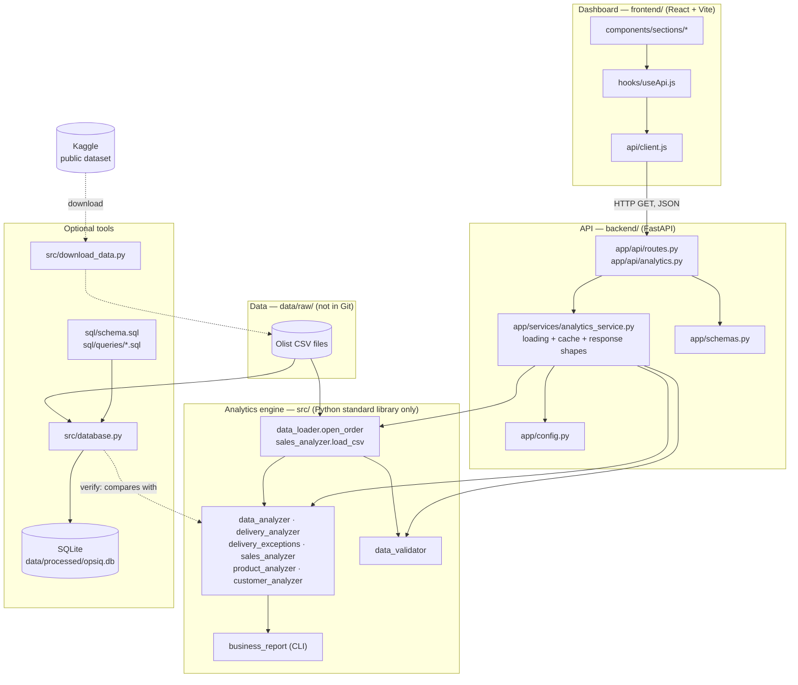
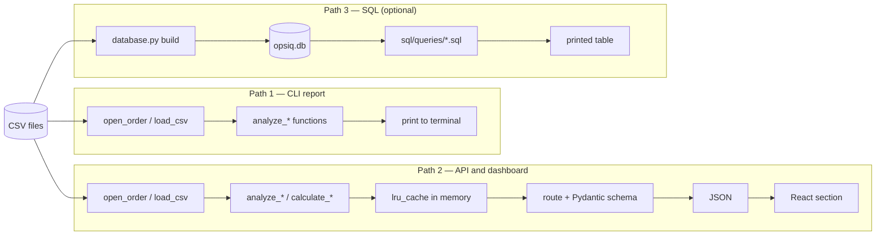
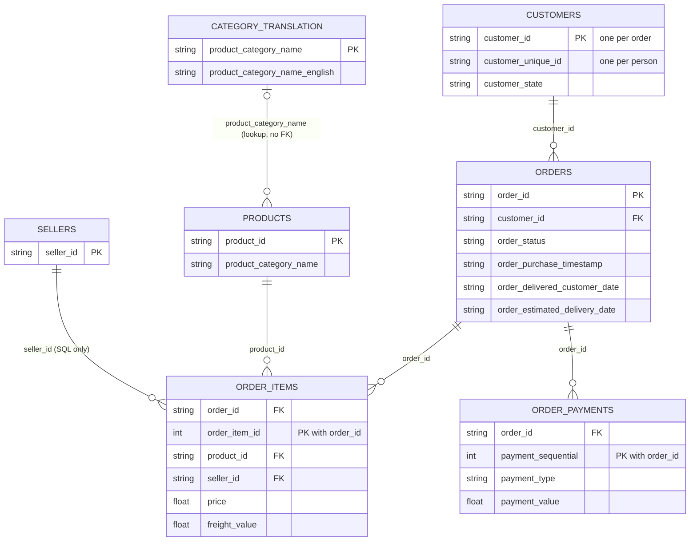
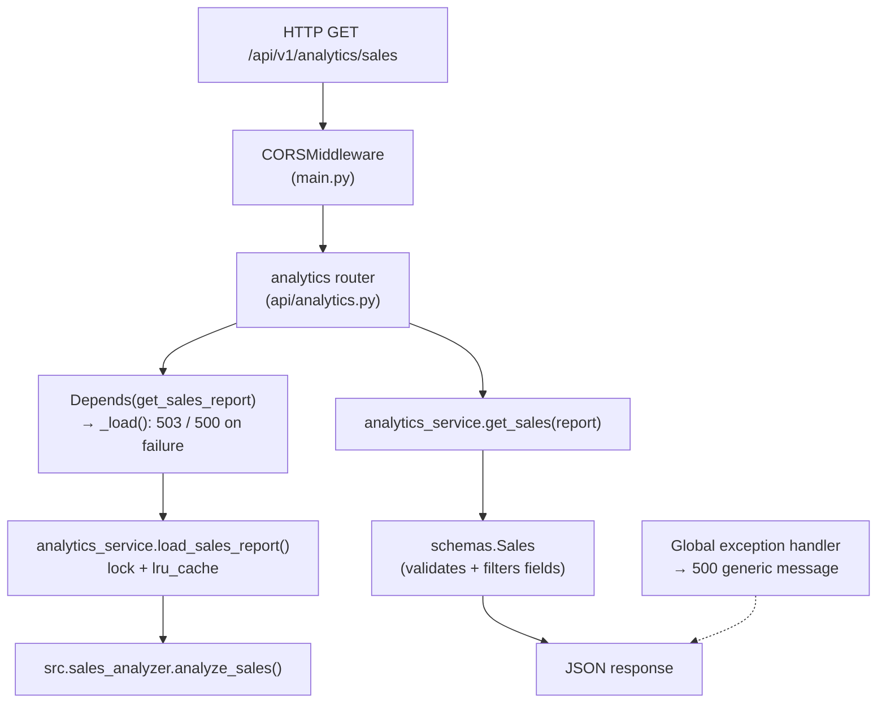
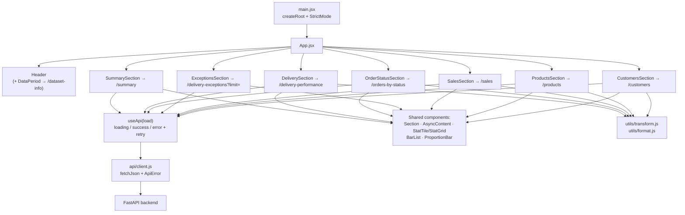
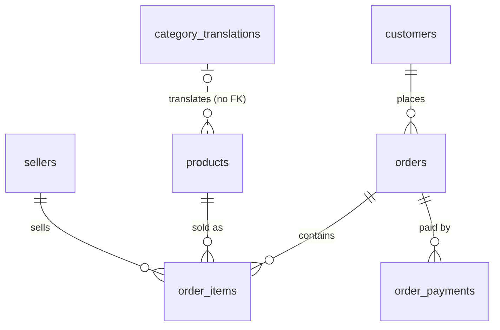
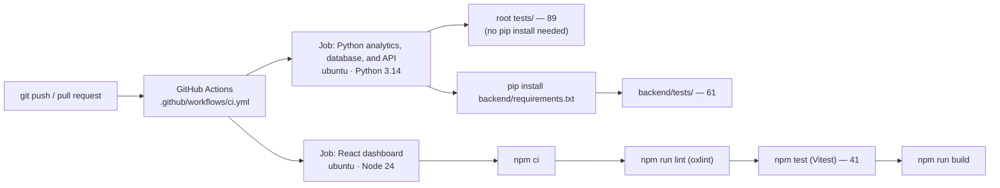
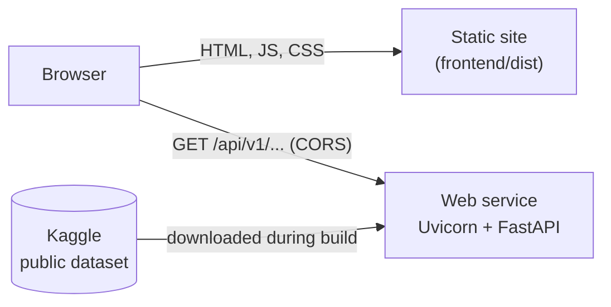

# OpsIQ Architecture

How OpsIQ is put together: which part does what, how data moves through it, and why it was designed this way. Every diagram here was checked against the code on **29 October 2026** (commit `ac32a9d`).

Related: [Master reference](PROJECT_MASTER_REFERENCE.md) (every module in detail) · [API reference](API_REFERENCE.md) · [Testing guide](TESTING_GUIDE.md) · [Deployment](DEPLOYMENT.md)

## Contents

1. [System architecture](#1-system-architecture)
2. [Data flow: three processing paths](#2-data-flow-three-processing-paths)
3. [Dataset relationships](#3-dataset-relationships)
4. [Backend / API architecture](#4-backend--api-architecture)
5. [Caching strategy](#5-caching-strategy)
6. [Error-handling strategy](#6-error-handling-strategy)
7. [Frontend architecture](#7-frontend-architecture)
8. [Database architecture](#8-database-architecture)
9. [Testing and CI/CD architecture](#9-testing-and-cicd-architecture)
10. [Deployment architecture (planned)](#10-deployment-architecture-planned)

---

## 1. System architecture

(The `SERVICE --> VAL` arrow is real: the API uses `data_validator.parse_order_date` to find the first and last purchase dates.)

| Component | Required? | Responsibility |
|---|---|---|
| CSV files | Yes | The source of truth. OpsIQ never changes them. |
| `src/` analytics engine | Yes | Every business rule. Functions take lists of row dictionaries and return dictionaries. No third-party packages. |
| CLI report | No (kept from Version 1) | Prints every metric to the terminal. |
| `backend/` API | For the dashboard | Turns the analytics into HTTP endpoints. Has no business rules of its own; it calls `src/`. |
| `frontend/` dashboard | No | Displays API results. Never calculates business metrics (it only does display maths such as "late minus over-3-days"). |
| SQLite database | No | A relational copy of the data for SQL practice. **Neither the API nor the CLI nor the dashboard reads it.** |
| `download_data.py` | No | Downloads the public dataset (used on a new PC and during deployment). |

---

## 2. Data flow: three processing paths

OpsIQ has **three separate paths** from the CSV files. They share the same `src/` functions, which is why their numbers agree.

### Path 1 — CLI report (`python -m src.business_report`)

1. `open_order()` reads `olist_orders_dataset.csv`; `load_csv()` reads the items, payments, products, customers, and translation files. Every row becomes a dictionary of strings.
2. `analyze_sales`, `analyze_products`, and `analyze_customers` build their reports.
3. `generate_business_report()` counts orders, calls `find_delivery_exceptions()` and `analyze_delivery_performance()`, and prints everything.
4. Nothing is stored. Each run reads the files again (about 5 seconds on the full data).

### Path 2 — API and dashboard

Using "late deliveries" (7,826) as the example:

1. **CSV → rows.** The first request (or the startup warm-up thread) calls `load_order_metrics()`, which calls `open_order()`.
2. **Rows → metrics.** `calculate_order_metrics()` runs `count_orders_by_status`, `calculate_delivery_performance`, and `find_delivery_exceptions` once, and stores the results in a frozen `OrderMetrics` object. The raw rows are then released.
3. **Metrics → cache.** `lru_cache` keeps the `OrderMetrics` object in memory for the life of the server process.
4. **Cache → JSON.** `/api/v1/analytics/summary` receives the object through `Depends(get_order_metrics)`. `get_business_summary()` picks the fields, and the `BusinessSummary` schema checks and serialises them.
5. **JSON → screen.** `SummarySection` calls `useApi(api.getSummary)`. `fetchJson()` sends the request; `useApi` tracks loading/error/data; `StatTile` shows `formatNumber(7826)` → `7,826`.

### Path 3 — SQL (`python -m src.database …`)

1. `build` runs `sql/schema.sql` in a new temporary file, then imports seven CSV files in one transaction, converting empty strings to `NULL` and text to `INTEGER`/`REAL` where the schema says so.
2. If every table imports, the temporary file replaces `data/processed/opsiq.db`.
3. `query NAME` runs one file from `sql/queries/`; `late` runs a parameterised query; `verify` runs the SQL queries **and** the Python functions and compares 33 values.

---

## 3. Dataset relationships

This diagram shows only the relationships **that the code actually uses** (Python joins in `src/`, or foreign keys in `sql/schema.sql`).

Where each relationship is used:

| Relationship | Python (`src/`) | SQL |
|---|---|---|
| orders → customers (`customer_id`) | `customer_analyzer` maps each order to a person (`customer_unique_id`) | FK; `repeat_customers.sql`, `orders_per_customer.sql` |
| order_items → orders (`order_id`) | `sales_analyzer` (orders with items), `customer_analyzer` (spending per person) | FK |
| order_items → products (`product_id`) | `product_analyzer` (category of each item) | FK; `revenue_by_category.sql` |
| products → translations | `product_analyzer` (English names) | `LEFT JOIN` only — two categories have no translation |
| order_payments → orders | **Not joined in Python**: payments are only summed by `payment_type` | FK |
| order_items → sellers | Not used in Python | FK only |

Checked on the real data (29 Oct 2026): every item's `product_id` exists in products, and every order's `customer_id` exists in customers.

---

## 4. Backend / API architecture

| Layer | File | Knows about |
|---|---|---|
| App setup | `app/main.py` | Logging, CORS, startup warm-up thread, global error handler, router prefixes |
| Settings | `app/config.py` | Environment variables → a frozen `Settings` object |
| Routes | `app/api/routes.py`, `app/api/analytics.py` | URLs, query parameters, HTTP status codes |
| Service | `app/services/analytics_service.py` | Loading files, caching, choosing response fields. **No HTTP.** |
| Schemas | `app/schemas.py` | The exact shape of every JSON response |
| Business rules | `src/*.py` (project root) | The calculations. **No HTTP, no caching.** |

Design choices:

- **Versioned paths** (`/api/v1/...`) so a future incompatible version can live alongside this one.
- **Read-only:** every endpoint is `GET`; CORS only allows `GET`.
- **One endpoint per dashboard section**, so one failing section does not blank the whole page.
- **Dependencies for data:** routes declare the data they need with `Depends(...)`; tests replace these with sample data.
- **Response schemas** guarantee that unlisted fields (for example, top customers) can never appear in a response.
- **`null` instead of fake zeros:** a percentage of zero orders is `null`.
- **Import path:** `analytics_service.py` adds the project root to `sys.path` so it can `import src...`. That is why the API must run with the full repository present, from the `backend/` folder.

All endpoints: [API_REFERENCE.md](API_REFERENCE.md).

---

## 5. Caching strategy

| Question | Answer |
|---|---|
| What is cached? | The calculated results: one `OrderMetrics` object and the sales, product, and customer reports. Not the raw CSV rows. |
| Where? | In the API process's memory, using `functools.lru_cache(maxsize=1)` in `analytics_service.py`. |
| When is it filled? | In a background thread at startup (`OPSIQ_PRELOAD_DATA=true`), or by the first request that needs it. Measured on 29 Oct 2026: warm-up finished about 11 seconds after start. |
| Two requests before it is filled? | A lock (`_cache_lock`) makes the second wait for the first calculation instead of repeating it. |
| What if loading fails? | `lru_cache` does not store exceptions, so the next request tries again. |
| How is it refreshed? | Restart the server. Tests call `clear_cache()`. |
| How many times is each file read? | Once per cached report: orders twice (order metrics and customer report), order items three times (sales, products, customers). |
| Multiple server processes? | Each process has its own cache and does its own warm-up. The project runs one process. |
| Why not Redis? | One process, read-only data that only changes when the files change. An external cache would add a service with no benefit. |
| Measured cost | Cached responses ~5 ms (measured 29 Oct 2026). About 165 MB of memory after warm-up (measured in earlier work; **not re-measured** in this audit). |

Trade-off: the calculations are CPU-bound, and Python runs one thread at a time (the GIL). So during the warm-up, even `/health` can be slow to answer.

---

## 6. Error-handling strategy

| Layer | Strategy |
|---|---|
| `src/` | Raises normal Python exceptions (`FileNotFoundError`, `ValueError`). Skips orders with missing or unreadable dates and counts them. |
| CLI report | Catches `FileNotFoundError` for the six data files and prints which file is missing and where to put it. Other module CLIs (for example `python -m src.sales_analyzer`) do **not** catch it and show a traceback. |
| Service | No HTTP knowledge. Lets exceptions through, so they are never cached. |
| Routes (`_load`) | `FileNotFoundError` → **503** naming only the missing file. Any other loading error → **500** with a short message. Full details go to the log. |
| FastAPI | Invalid query parameters → **422**. Unknown paths → **404**. Wrong method → **405**. |
| Global handler (`main.py`) | Any other exception → **500** `{"detail": "An unexpected server error occurred."}`; stack trace only in the log. |
| Frontend client | Network failure → "Could not reach the OpsIQ API at …". HTTP error → the API's `detail` message. |
| Frontend UI | Each section shows its own error and a "Try again" button; other sections keep working. |

Observed on 29 Oct 2026 with an empty data folder: `/health` → 200, analytics → 503 with the file name, and no folder paths in the response. One quirk: with **no data**, `?limit=0` also returns 503 (not 422), because the data dependency fails before the parameter is checked. With data present, it correctly returns 422.

---

## 7. Frontend architecture

- **One page**, no router. The header nav links jump to sections (`#summary`, `#delivery`, …).
- **Each section fetches its own data** through `useApi`, so sections load and fail independently.
- **No chart library.** Charts are HTML lists and `` bars (`BarList`, `ProportionBar`) with the values printed as text.
- **Styling:** one CSS file (`src/index.css`) with CSS variables (colour tokens). Dark colours switch automatically with the operating system setting (`prefers-color-scheme`); there is no manual toggle.
- **Configuration:** `VITE_API_BASE_URL` (default `http://127.0.0.1:8000`).

Section-by-section detail: [PROJECT_MASTER_REFERENCE.md §8](PROJECT_MASTER_REFERENCE.md#8-frontend-and-dashboard).

---

## 8. Database architecture

- **Engine:** SQLite (Python's built-in `sqlite3`). One file: `data/processed/opsiq.db` (about 98 MB). **Not in Git**; rebuild with `python -m src.database build`.
- **Tables:** `customers`, `sellers`, `category_translations`, `products`, `orders`, `order_items`, `order_payments`.
- **Not imported:** geolocation (no unique key) and reviews (duplicate `review_id`s, not used by any metric).

Design decisions:

- **Column names match the CSV headers** (including Olist's spelling `product_name_lenght`), so every value is traceable.
- **Timestamps are `TEXT`** in `YYYY-MM-DD HH:MM:SS`; `julianday()` turns them into days for date maths.
- **No foreign key from products to translations:** two categories have no translation.
- **Indexes** on the join and filter columns: `orders.customer_id`, `orders.order_status`, `order_items.product_id`, `order_items.seller_id`, `customers.customer_unique_id`, `order_payments.payment_type`.
- **Repeatable build:** written to `opsiq.db.building` in one transaction and swapped in only on success.
- **Manual, not automatic:** nothing builds the database for you.

Every column and query: [PROJECT_MASTER_REFERENCE.md §7](PROJECT_MASTER_REFERENCE.md#7-sql-and-database).

---

## 9. Testing and CI/CD architecture

| Suite | Tests | What it covers | Data |
|---|---:|---|---|
| `tests/` | 89 | Analytics modules, validation, CLI report, SQLite build and queries, download helper | Hand-written rows and temporary CSV files |
| `backend/tests/` | 61 | Every endpoint, empty data, missing/broken files, 404/422/500/503, no leaked paths or customer data, caching, CORS, settings, agreement with the CLI report | Sample orders and temporary CSV folders |
| `frontend/src/**/*.test.*` | 41 | Formatting, chart transforms, API client, components, loading/error/empty states, retry, the limit selector, the whole page with a mocked API | Mocked `fetch` |

- **No test needs the real dataset**, so CI downloads nothing.
- **CI status:** runs #1 and #2 on GitHub both **passed** (29 Oct 2026).
- **Not automated:** browser end-to-end tests, code coverage, and SQL-vs-Python verification on the full data (`verify` is run by hand).

Earlier work (before this audit) reports a manual Playwright check of the dashboard at 1440 px and 390 px and in dark mode. That script is **not in the repository**, and this audit could not repeat the mobile and dark-mode checks. See [TESTING_GUIDE.md](TESTING_GUIDE.md).

---

## 10. Deployment architecture (planned)

**Status: configured, not deployed.**

- The **dashboard** is static files (`npm run build`).
- The **API** is one Python process. At build time it installs `backend/requirements.txt` and runs `python -m src.download_data`; at startup it warms its cache.
- The two connect only through configuration: `VITE_API_BASE_URL` (dashboard build) and `OPSIQ_CORS_ORIGINS` (API).
- No database server and no persistent disk.

Steps: [DEPLOYMENT.md](DEPLOYMENT.md).
